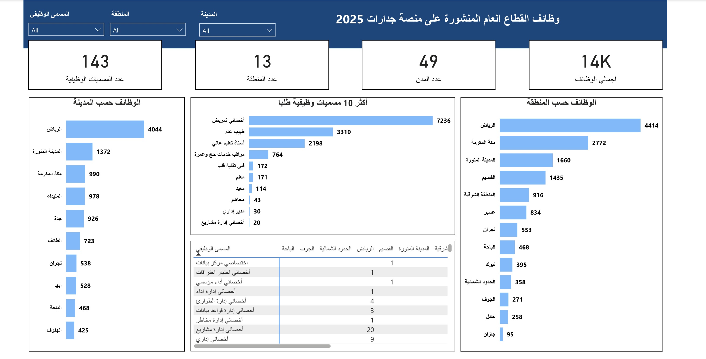

# لوحة تحليل وظائف القطاع العام على منصة جدارات 2025

لوحة تحليلية تفاعلية في Power BI توضح توزيع وظائف القطاع العام المنشورة على منصة جدارات خلال عام 2025، حسب المنطقة والمدينة والمسمى الوظيفي.

## صورة Dashboard 

## المؤشرات الرئيسية

- **إجمالي الوظائف:** حوالي 14 ألف وظيفة
- **عدد المسميات الوظيفية:** 143
- **عدد المناطق:** 13
- **عدد المدن:** 49

## أبرز النتائج

- **منطقة الرياض** تتصدر بـ 4,414 وظيفة، أي قرابة ثلث الوظائف، تليها مكة المكرمة (2,772) ثم المدينة المنورة (1,660).
- **القطاع الصحي** يسيطر على الطلب: أخصائي تمريض وحده يمثل أكثر من نصف الوظائف (7,236)، ومع طبيب عام (3,310) يصلان لحوالي ثلاثة أرباع الإجمالي.
- **أستاذ تعليم عالي** ثالث أكثر مسمى مطلوب (2,198) يليه مراقب خدمات حج وعمرة (764).
- **منطقة جازان** الأقل في عدد الوظائف المنشورة (95 وظيفة).

## المميزات

- فلاتر تفاعلية حسب المسمى الوظيفي والمنطقة والمدينة
- مقارنة الوظائف حسب المنطقة والمدينة
- أكثر 10 مسميات وظيفية طلبًا
- جدول يوضح توزيع المسميات الوظيفية على المناطق

## الأدوات

- Power BI Desktop
- DAX

## مصدر البيانات

منصة جدارات

## الملفات

- [Jadarat-Dashboard.pbix](Jadarat-Dashboard.pbix): ملف التقرير
- [jadarat-dashboard.png](jadarat-dashboard.png): Dashboard

